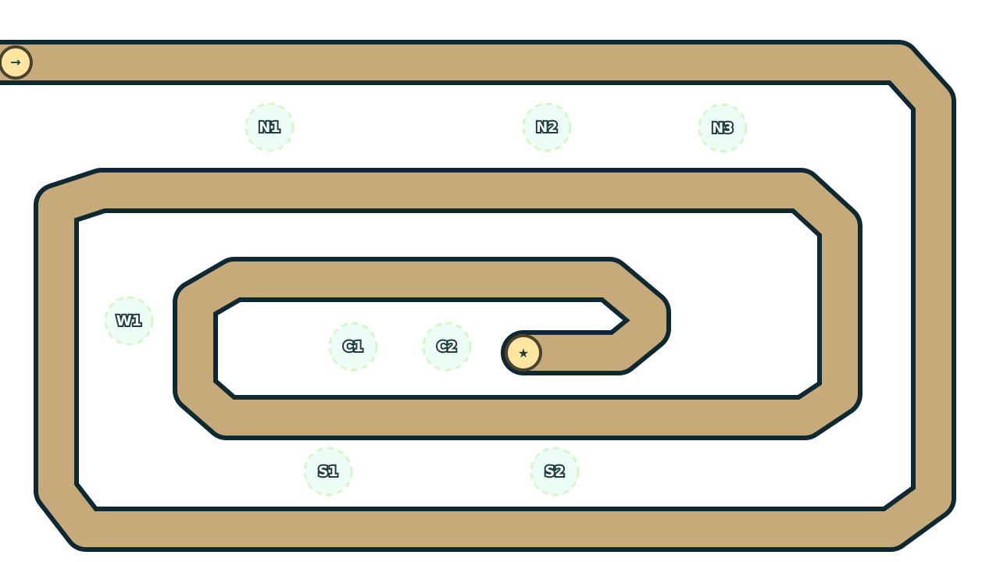

# Карта 03 — Поля ветряков (`windmill-fields`)

## Игровая задача и ограничения

Поля сети маяков защищают центральный энергетический узел. Противник входит **слева сверху** в `(0,80)`, обходит внешнюю кромку поля и последовательно сужает спираль до **видимого терминала** `(670,452)`. Единственная полоса имеет ширину 46 мировых пикселей. Три крупные террасы внутри витков предназначены для перекрывающегося огня; вокруг них остаются запасные сухие позиции. Мельницы — исключительно декорация с явными запретными восьмиугольниками.

| Контракт | Значение |
|---|---|
| `id`, индекс кампании, геометрическая группа | `windmill-fields`, 3, 1 |
| Тема и рекомендованная настройка | `garden`, `easy` |
| Число полос и их длина | 1, **6245,6 px** (21 сегмент) |
| Мир | 1280×720 |
| Первое открытие карты | `needle`, `cannon`, `frost`, `beacon`, `scatter`, `ember`, `saw`, `venom` |
| Только **после победы** | `rail`, `tesla` |
| Задача | подключить энергетический узел |
| Волны | определяются выбранной сложностью: easy 40, normal 60, hard 80, extreme 100 |
| Изменения волн | `waveOverrides:{}` — отсутствуют до проверки общего каталога |

`MapDef` не должен сам выдавать башни: кампанию и unlocks обрабатывает `getCampaign()` другого модуля. Никакие `rail`/`tesla` не включаются в стартовые стратегии. Карта не прячет маршрут и не переключает полосы. Сюжетная геометрическая группа `difficulty:1` **не** сокращает количество волн.

## Пространство, окружение и размещение

| Точка | Координаты | Применение |
|---|---|---|
| N1 | (345,163) | Северный ранний перехват: заморозка и дальний огонь по внешнему/внутреннему верхнему витку |
| N2 | (700,163) | Вторая верхняя опора для огня/горения, поддерживает N1 |
| N3 | (925,164) | Резерв верхнего витка для разведки скрытых, усиления или альтернативной композиции |
| W1 | (165,411) | Сильный западный поворот: яд/контроль, прикрытие западного обхода |
| C1 | (452,444) | Ключевая середина: одновременно видит верхний и нижний подход к центру |
| C2 | (572,444) | Второй центральный сектор: концентрированный урон и защита терминала |
| S1 | (420,604) | Южное перекрытие внутренних и наружных витков |
| S2 | (710,604) | Альтернативный южный сектор: конус/линейный прострел |
| A/B | (497,301)/(950,318) | Водные точки будущих повторных прохождений; не нужны для первой победы |

Все восемь сухих центров проходят проверку окружности **радиусом 30 px**, не попадают в дорогу, воду или `blocked`. Для двух водных точек проверен внутренний радиус **18 px**. Фактический `TowerDef.footprint` каждого вида должен быть повторно проверен в центральной симуляции после заполнения каталога. Сценические мелкие растения не объявляются коллизией и не маскируют места установки. Два пруда нарисованы теми же многоугольниками, что и `MapDef.water`.

Независимый анализатор подтвердил: минимальная длина сегмента 21 px, минимальное расстояние **между отдельными витками** (не между участками одного локального изгиба) 64,4 px, минимальный зазор от края `water/blocked` до полотна 2 px. Все вершины в пределах мира, нет пересечений раздельных участков, пути нулевой длины, самопересечений полигонов и наложений заявленных стартовых footprints. Следует сохранять небольшое визуальное поле зазором 2 px у некоторых прудов — это не дополнительная доступная суша для башен.

Полный путь при **постоянной** скорости босса 17 px/s занял бы примерно **367,4 s** игрового времени без контроля и ускорений; это грубая оценка по геометрии, не результат симуляции. Первая точка обстрела при радиусе 150 px находится на отметке 224 px от входа: 2,99 s при условной скорости 75 px/s или 1,49 s при 150 px/s. Более быстрые враги и их реальные скорости ещё требуют проверки. Здесь есть достаточно места для реакции и распознаваемая точка выхода без внезапных ответвлений.



## Предварительные композиции, не доказательства победы

Три воспроизводимых сценария лежат в [`validation/maps/windmill-fields/replays.json`](../../validation/maps/windmill-fields/replays.json); там **все** команды имеют номер волны, тик внутри неё (нулевой тик — фаза строительства до запуска), ID башни или ветвь улучшения, метку слота и координаты. Все сценарии используют `easy`, **одного игрока**, **без знаний**, seed `400301`/`400302`/`400303`; ни одной ещё не открытой башни. Никаких внеигровых начислений, продажи или скрытых бонусов нет.

| Режим | Стартовые покупки | Стартовая сумма | Отличие / реакция на угрозы |
|---|---|---:|---|
| standard | C1 needle; N1 frost; S2 scatter | 213 + 425 + 362 = **1000** из 1000 | Сначала замедление и дробь на двух витках, далее C2 cannon против брони/боссов; W1 venom против стойких; N3 beacon B против скрытых и фаз щита |
| half-cash | C1 needle; N1 needle | 213 × 2 = **426** из 500 | Максимально дешёвые начальные атаки; третья needle на S2 до волны 4, затем scatter и frost, проверка реальных выплат за снятые слои особенно важна |
| iron-oath | C1 needle; N1 frost; S2 needle | 213 + 425 + 213 = **851** из 1000 | Распределённый контроль: C2 cannon, южная scatter, W1 venom, N2 ember, N3 beacon для обнаружения. Без ферм, доходных способностей, продажи и знаний; предел 1 жизнь должен обеспечить engine |

Порядок контрмер также зафиксирован в действиях: до 10-й волны — cannon/его ветка A против толстого босса, перед 20-й — scatter и усиленный splash против потомков, перед 40-й — разведка через beacon B и дополнительный урон по фазам. **Это гипотезы для боевого испытания**, а не доказанная достаточность. В частности, half-cash может оказаться недостаточно силён к боссу 10-й волны; такая неудача должна быть зарегистрирована и исправлена на основе реального replay, без искусственного облегчения.

### Денежные границы

На `easy` цены без знаний/скидки поддержки: `needle 213`, `cannon 468`, `frost 425`, `beacon 510`, `scatter 362`, `ember 510`, `saw 553`, `venom 553`. Все вычислены как `ceil(base×0.85)`. Реальная стоимость улучшений зависит от `UpgradePath` и проверяется движком отдельно. Начало: `1000` кредитов в standard/iron-oath и `500` в half-cash.

Минимально возможный доход **только от успешно завершённых волн**, без выплат за снятые слои и без затрат на улучшения:

| Перед волной | Завершено | standard / iron-oath | half-cash |
|---:|---:|---:|---:|
| 1 | 0 | 0 | 0 |
| 4 | 3 | 330 | 165 |
| 10 | 9 | 1125 | 562 |
| 20 | 19 | 2850 | 1425 |
| 40 | 39 | 7800 | 3900 |

Рассчитывается по `sum(100+5n)` для `n=1..completed` (в half-cash ×0,5 с переносом субкредитов). Эти суммы — **условные на победы во всех предшествующих волнах**, не прогноз текущего баланса. Анализатор `run-replays.ts --static` отдельно показывает остаток после **только** базовых покупок. Отрицательный остаток у ряда ранних half-cash и iron-oath команд прямо указывает на зависимость от фактических слойных выплат. Положительный остаток тоже не гарантирует доступность покупки, потому что в нём **не учтены улучшения**. Действительный статус покупки устанавливает только `engine.dispatch`, который проверяет кредитный баланс и легальность.

## Исполняемый replay и приёмка

```bash
npm ci --ignore-scripts
npm run check
node --import tsx validation/maps/windmill-fields/check.ts
node --import tsx validation/maps/windmill-fields/run-replays.ts --static
node --import tsx validation/maps/windmill-fields/run-replays.ts --simulate
```

`--static` проверяет три профиля, расписание, легальность всех начальных footprints, бюджет волны 1, отсутствие `rail/tesla`, допустимые ветки и непротиворечивые слоты. `--simulate` вызывает настоящие `loadContent`, `createCombat`, `createGame`, отправляет команды через `dispatch`, делает шаги по `1/60`, проверяет принятые покупки и каждое завершение волны, затем возвращает финальные жизни, кредиты, расходы, доход и признак победы. Любая отклонённая покупка, поражение, зависание, несвоевременная победа или отсутствие `entity` в ответе приводят к провалу; тест не дорисовывает победу сам.

На базовом коммите `65ae156…` контент, волны, враги и engine ещё являются заглушками с `throw new Error`. Поэтому статус JSON — **`verification: "unverified"`**, `expected.won`, `expected.endingLives`, `expected.endingCredits` — `null`. Выполнение `--simulate` сейчас честно завершится с `NOT VERIFIED` (exit 2). После интеграции необходимо прогнать его вновь, проанализировать отказавшие покупки и перемещение врагов, настроить приобретения/ветки, при необходимости явно добавить локальные `waveOverrides` с реально существующими EnemyDef ID, и только после успешной победы всех трёх режимов включать боевую приёмку в общий статус. Сам модуль не утверждает прохождение всех 40 волн или баланс.

## Графика и эксплуатация

- `background.svg` — векторная местность 1280×720 с полями, всеми объявленными прудами и блокирующими мельницами. **Без нарисованной дороги и UI:** игру не заставляют рисовать путь/башни два раза.
- `thumbnail.svg` — отдельная стилизованная композиция 640×360 для выбора карты, с читаемым русским названием.
- `preview.html` — автономная проверочная сцена 16:9 с наложенным маршрутом и отключаемыми группами дороги, сухих и водных позиций; внутри игры этот HTML не загружается.
- `validation/maps/windmill-fields/overview.svg` — визуальная техническая схема; это **не** изображение во время игры и **не** скриншот HTML.

SVG фон и миниатюра реально экспортировались в **1366×768** и просмотрены. Техническая схема дороги также реально экспортирована в **1366×768** и просмотрена; расположение N/C/S/W, декоративных мельниц, двух прудов и терминала читаемо. Для `preview.html` попытка установить headless Chromium была безуспешна (загрузчик вернул повреждённый/пустой архив); полноценное открытие именно HTML в браузере в текущей среде **не подтверждено**. HTML использует только локальный SVG, CSS и небольшой встроенный JS; внешних URL, CDN, шрифтов, трекеров и звуков нет. Звуков у этой карты по контракту нет: мировое аудио — соседний модуль.

Карта не меняет генератор контента, контракты, кампанию, каталог волн, файлы других карт, renderer и сборочные настройки. Необходимые общие проверки после слияния: точные радиусы `TowerDef.footprint`, время до первого попадания с реальными скоростями и дальностями, collision placement у всех восьми точек, первые 40/60/80/100 волн на всех сложностях, синхронизация mark/выхода renderer, три фиксированных replay и режимы с отдельными правилами. Проверка 2/4 клиента и экономических гонок находится за границей независимого модуля карты.
