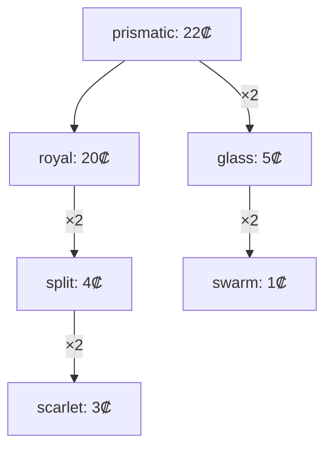

# 24 обычных врага — Prism Bastion v1

`src/content/enemies.ts` экспортирует `getEnemies():EnemyDef[]`: 24 неизменных ID и независимые глубокие копии вложенных игровых данных. Данные не содержат функций поведения. Боевая симуляция остаётся владельцем попаданий, оплаты и появления потомков.

## Внешний каталог

Открыть `public/art/enemies/preview.html` в браузере. Офлайн-страница содержит для всех 24 врагов HP, скорость, утечку, награду, специальные характеристики, точные денежные слои, общую стоимость распада и конкретный контрприём. Кнопка «Снять слой» циклически переключает настоящие SVG-состояния.

В `public/art/enemies/` расположены 24 базовых `id.svg` и 48 `id-layer-N.svg` — всего 72 автономных SVG 128×128, прозрачный фон, центр (64,64). Каждому типу соответствует собственная пиктограмма на одном из пяти силуэтов (сфера, ромб, шестиугольник, осколок, корона). Отдельные значки показывают щит, броню, полёт, скрытность, регенерацию и деление. Цвет меняется при потере оболочки, а число светлых ромбов внизу сообщает остаток слоёв без требования различать оттенки. В SVG нет внешних изображений, скриптов, шрифтов или сетевых ссылок.

После изменения цветов/описаний файлы можно восстановить и проверить без ручного редактирования:

```sh
node --import tsx public/art/enemies/generate.mjs
node --import tsx public/art/enemies/generate.mjs --check
```

## Исходные числа

Слои перечислены **снаружи внутрь** в формате HP/₡. Бюджет включает родителя и полный возможный распад. Все неуказанные защиты равны нулю, `cloaked=false`, `flying=false`. Скорость — пикселей в секунду.

| ID | HP | Скорость | ₡ | Утечка | Защита / потомки | Слои HP/₡ | Всего ₡ |
|---|---:|---:|---:|---:|---|---|---:|
| scarlet | 12 | 52 | 3 | 1 | — | 5/1, 7/2 | 3 |
| amber | 22 | 72 | 4 | 1 | скорость | 7/1, 7/1, 8/2 | 4 |
| lemon | 14 | 115 | 4 | 1 | скорость | 4/1, 4/1, 6/2 | 4 |
| jade | 58 | 46 | 6 | 2 | HP | 15/1, 18/2, 25/3 | 6 |
| azure | 35 | 82 | 5 | 1 | сбалансирован | 9/1, 11/2, 15/2 | 5 |
| violet | 80 | 58 | 7 | 2 | щит 45 | 20/2, 25/2, 35/3 | 7 |
| iron | 130 | 38 | 9 | 3 | броня 8 | 35/2, 40/3, 55/4 | 9 |
| glass | 25 | 70 | 5 | 1 | 2× swarm | 7/1, 8/2, 10/2 | 7 |
| cloak | 48 | 65 | 7 | 2 | скрытность | 12/2, 16/2, 20/3 | 7 |
| regrow | 95 | 42 | 8 | 2 | регенерация 4 HP/с | 25/2, 30/3, 40/3 | 8 |
| shield | 95 | 45 | 9 | 2 | щит 100 | 25/2, 30/3, 40/4 | 9 |
| split | 75 | 48 | 4 | 2 | 2× scarlet | 20/1, 25/1, 30/2 | 10 |
| ruby | 180 | 40 | 12 | 4 | огонь −50% | 45/3, 60/4, 75/5 | 12 |
| glacier | 160 | 42 | 12 | 3 | холод −50% | 40/3, 50/4, 70/5 | 12 |
| copper | 210 | 44 | 13 | 4 | электричество −50% | 55/3, 65/4, 90/6 | 13 |
| obsidian | 350 | 32 | 16 | 5 | броня 20 | 80/4, 120/5, 150/7 | 16 |
| dart | 70 | 132 | 8 | 2 | летающий | 18/2, 22/3, 30/3 | 8 |
| swarm | 9 | 95 | 1 | 1 | рой | 9/1 | 1 |
| aegis | 330 | 35 | 17 | 5 | щит 300 | 75/4, 100/5, 155/8 | 17 |
| royal | 450 | 40 | 20 | 6 | броня 12; 2× split | 100/5, 150/6, 200/9 | 40 |
| hollow | 120 | 75 | 10 | 3 | скрытность | 30/2, 40/3, 50/5 | 10 |
| prismatic | 600 | 36 | 22 | 7 | royal + 2× glass | 70/2, 90/3, 120/4, 140/5, 180/8 | 76 |
| juggernaut | 1000 | 24 | 30 | 10 | высокий HP | 200/7, 300/9, 500/14 | 30 |
| herald | 1600 | 28 | 40 | 12 | броня 8; щит 160; royal + 2× dart | 300/7, 400/9, 400/10, 500/14 | 96 |

### Дочерние графы и точные бюджеты



`glass = 5+2×1 = 7`; `split = 4+2×3 = 10`; `royal = 20+2×10 = 40`; `prismatic = 22+40+2×7 = 76`; `herald = 40+40+2×8 = 96`. Максимальный путь: `prismatic/herald → royal → split → scarlet`, ровно три поколения потомков. Циклы и неизвестные ID запрещены тестами. Потомки имеют собственные `layers` и не получают бонуса из награды за гибель родителя.

## Интеграция снятия денежных слоёв

`EnemyDef.layers` перечисляет оболочки снаружи внутрь. `sum(layer.hp)=hp`, `sum(layer.cash)=bounty`: `bounty` — контрольная сумма, а не дополнительная плата. Например, `scarlet`: после первых 5 снятых HP заплатить 1 ₡, после следующих 7 HP ещё 2 ₡. Мощное попадание на 12 HP может снять оба слоя и принести 3 ₡.

`EnemyState.paidLayers` хранит индексы уже оплаченных оболочек и не очищается при восстановлении HP, сохранении, реконнекте или смене фазы. Визуальное состояние берите по количеству последовательно снятых слоёв: `id.svg` для начального, `id-layer-1.svg` после первого, далее по индексу. Не связывайте смену с интерполяцией HP: регенерация не должна возвращать оплаченный цвет и повторный доход. Последний вариант используется для анимации гибели.

HP множится на модификаторы сложности и кооператива, поэтому пороги отдельных слоёв масштабируются на `EnemyState.maxHp / EnemyDef.hp`. Денежные выплаты не умножаются на HP; порядок и округление income остаются у frozen `runtime.credit`. Щит и броня не создают оплачиваемых HP-слоёв. `enemyArt(id)` существующего модуля графики возвращает базовый файл; renderer может переключать дополнительные варианты по описанному соглашению имён, без изменения frozen контракта.

## Балансировочные решения

Все исходные числа HP, скорости, `bounty` и потерь жизней сохранены. Сохранены из общего дизайна броня 8 у Iron, броня 20 у Obsidian, регенерация 4 HP/с, щиты Shield 100 / Aegis 300, три сопротивления по 50%, скрытность Cloak/Hollow и полёт Dart. Дополнительно определены щит 45 у Violet для обучения, броня 12 у Royal, броня 8 и щит 160 у Herald. Для неопределённых ранее распадов выбраны Glass→2 Swarm, Royal→2 Split, Prismatic→Royal+2 Glass, Herald→Royal+2 Dart. Радиусы 9–28 мировых пикселей зависят от размера цели и не меняются при визуальном снятии оболочки.

Контрприёмы даны непосредственно в `description` каждого врага и продублированы в офлайн-каталоге. Полная проходимость 100 волн не доказывается данным модулем: её требуется проверять replay после интеграции движка и волн.

## Проверки

```sh
npm test -- --run tests/content/enemies.test.ts
node --import tsx public/art/enemies/generate.mjs --check
npm run check
```

Тестируются точные ID/статы, полные и локальные бюджеты, независимые копии, свойства, сопротивления, циклы, поколения, все 72 ресурса и офлайн-превью. Генератор в `--check` не изменяет файлы. Незавершённые соседние модули этой веткой не редактируются.
